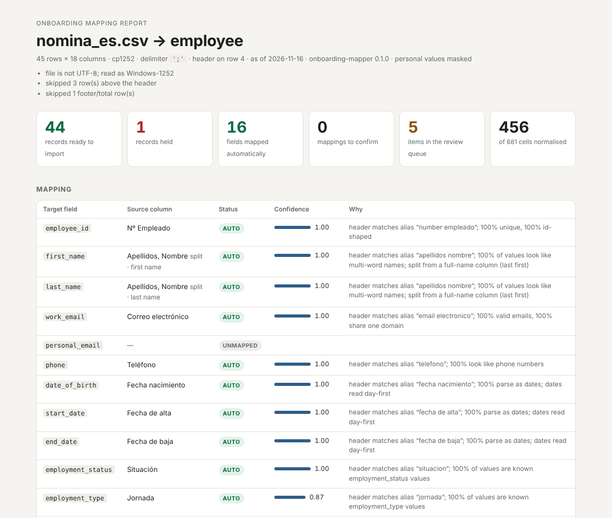
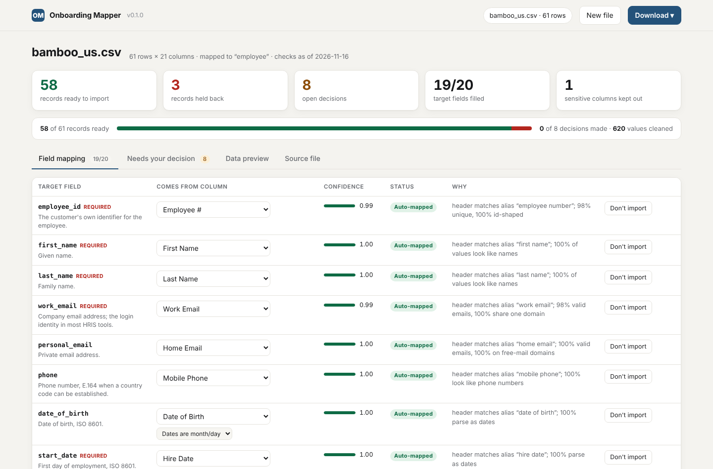
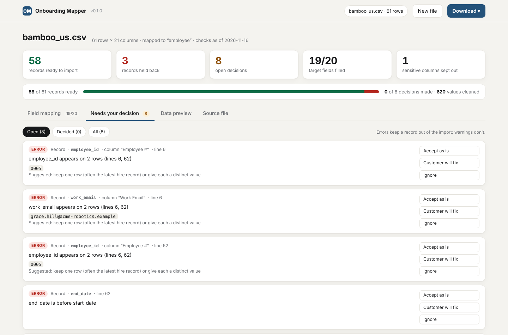
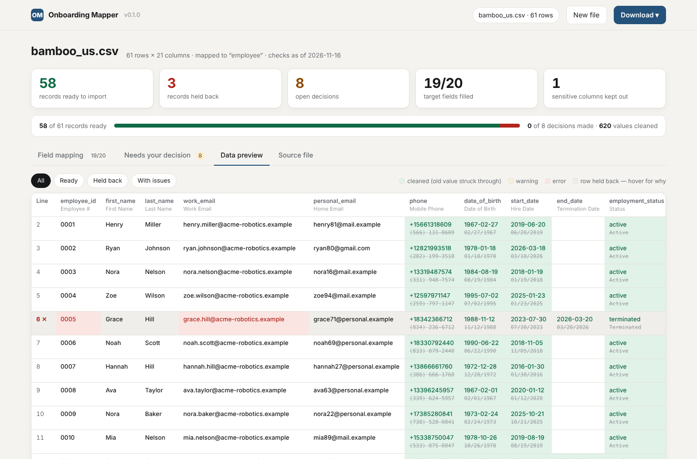
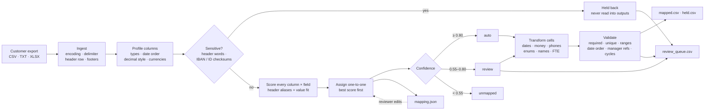

# onboarding-mapper

**Turn a customer's messy HR export into a clean import file, and show exactly what a person still has to decide.**

The first week of most HR-software deployments goes to one file: the customer's employee export. It comes from a
payroll system in Windows-1252 with title rows on top. Dates are `03/04/2021`, and nobody knows whether that is
March or April. Names arrive as `García López, María`. Salaries are `62.500,00 €`. An "Employment Status" column
holds contract types, and somebody's IBAN sits in column K.

`omap` reads that file, proposes a mapping to a target schema with a confidence score and a reason for every field,
applies it, validates every cell and record, and writes:

| File | What it is |
|---|---|
| `mapped.csv` | records ready to import, in target-schema order |
| `held.csv` | records with at least one error, and why |
| `review_queue.csv` | every decision a person still has to make, one line each, with a `decision` column |
| `mapping.json` | the mapping with confidences and reasons; a reviewer edits it, `omap apply` re-runs with it |
| `report.html` / `.md` / `.json` | the run in numbers for the customer or the team; personal values masked by default |

It is deterministic: no model API and no network. Employee data never leaves the machine, and the same input gives
byte-identical output. Runtime dependencies: none (Python 3.10+ standard library).



## The client panel

```bash
omap ui        # opens http://127.0.0.1:8765 in your browser
```

A local web app for the person who owns the data: drop the export (or pick a sample), check the proposed mapping,
change any column from a drop-down, work through the decisions, and download the clean file. It runs on
`127.0.0.1` with the standard library only. The file goes from the browser to this process and nowhere else, and
requests from other web pages are refused.

| Field mapping | Needs your decision | Data preview |
|---|---|---|
|  |  |  |

- **Field mapping:** every target field, the column it comes from, confidence, status and the reason. Change the
  column, confirm, or exclude, and everything re-checks at once. Date order and decimal style can be switched per column.
- **Needs your decision:** each open item with *Accept as is*, *Customer will fix* or *Ignore*. Decisions go into the
  downloaded `review_queue.csv`.
- **Data preview:** output cells with the old value struck through, warnings in amber, errors in red, held rows in grey.
- **Source file:** encoding, delimiter, header row, and what each column looks like. Sensitive columns show no values.
- **Download:** `mapped.csv`, `held.csv`, `review_queue.csv`, `mapping.json` (reusable next month), `report.html`.

## Results

All numbers below come from `python bench/evaluate.py` and `python bench/speed.py` in this repo. The data is synthetic,
generated with ground truth for every cell (`examples/truth/`).

### Development fixtures

These four exports were used while building the matcher, so this table is a **regression score, not an accuracy
claim**. CI fails if any number drops.

| Export | Damage built in | Fields mapped right | Auto-applied and right | Cells right | Planted problems found |
|---|---|---:|---:|---:|---:|
| `bamboo_us.csv` | MM/DD dates, `$` amounts, "Employment Status" holding contract types, manager by name, SSN, emergency phone, a rehire with a duplicate id | 20/20 | 18/18 | 1,159/1,159 | 5/5 |
| `nomina_es.csv` | Windows-1252, `;`, title and total rows, `Apellidos, Nombre`, DNI/NIE and IBAN, decimal commas, Excel serial dates, a 2-digit year, a monthly salary in the annual column | 20/20 | 16/16 | 720/720 | 2/2 |
| `hris_de.xlsx` | real date cells, numeric ids, manager by email (one missing), `€ 52.000`, Steuer-ID and Konfession columns, a start date typed as 2062 | 20/20 | 18/18 | 900/900 | 2/2 |
| `spreadsheet_hell.csv` | no id column, a "Title" column of Mr/Ms/Dr, `Name <email>` cells, three date formats in one column, `48k` / `€48,000` / `48000 EUR` | 20/20 | 14/14 | 420/420 | 30/30 |

### Held-out export

`holdout_fr.csv` (French HRIS: long French headers, a CDI/CDD column beside the full/part-time column, `45 000,00`,
`80 %`, social security number and RIB) was written **after** the lexicon was frozen. Its first run is recorded
unedited in [`bench/HOLDOUT_FIRST_RUN.md`](bench/HOLDOUT_FIRST_RUN.md):

| | First run | After one fix |
|---|---:|---:|
| Fields mapped right | 20/20 | 20/20 |
| Auto-applied and right | 19/19 | 19/19 |
| Cells right | 756/760 (99.5%) | 760/760 |
| Sensitive columns held back | 2/2 | 2/2 |

The 4 misses were all `En congé parental`. None was silent: each landed in the review queue as an unknown status
value. The fix was general rather than a new synonym: a value now matches when it contains a known multi-word
phrase ("congé parental") and every phrase it contains points to the same value.

One held-out file from the same author is a weak test. The useful signal is the failure mode: **an unknown value
goes to a person, never to a guess.**

### What a person still decides

| Export | Rows | Fields auto / to confirm | Cells normalised | Records held | Review queue |
|---|---:|---:|---:|---:|---:|
| `bamboo_us.csv` | 61 | 18 / 1 | 620 of 1,107 | 3 | 8 items |
| `nomina_es.csv` | 45 | 16 / 0 | 456 of 681 | 1 | 5 items |
| `hris_de.xlsx` | 50 | 18 / 0 | 349 of 852 | 1 | 5 items |
| `spreadsheet_hell.csv` | 30 | 14 / 0 | 259 of 394 | 30 (no id column) | 2 items |
| `holdout_fr.csv` | 40 | 19 / 0 | 326 of 725 | 0 | 2 items |

I have not timed a person doing these by hand, so there is no "hours saved" figure here. The countable part:
on the US export, 18 of 20 field decisions and 620 cell rewrites are done for you, and the person reads 8 lines.

### Speed

`python bench/speed.py`: the US export (21 columns) scaled up, one process, median of 3 runs up to 10k rows.

| Rows | File | Read | Profile + match | Apply + validate | Total | Rows/s |
|---:|---:|---:|---:|---:|---:|---:|
| 1,000 | 0.2 MB | 23 ms | 565 ms | 72 ms | 660 ms | 1,516 |
| 10,000 | 2.4 MB | 202 ms | 1,063 ms | 766 ms | 2,060 ms | 4,853 |
| 50,000 | 12.1 MB | 1,252 ms | 1,533 ms | 4,088 ms | 6,874 ms | 7,274 |
| 100,000 | 24.2 MB | 2,520 ms | 2,340 ms | 8,265 ms | 13,125 ms | 7,619 |

Python 3.13, Linux x86_64, 2 CPUs. Profiling looks at the first 2,000 values per column, so matching time flattens
as files grow. An early version took 21 s for 50k rows because a required-field check rescanned every issue for
every row; the benchmark caught it.

Tokens and model cost: zero. There is no model call anywhere.

## How it works



**1. Headers and values vote separately.** Each candidate pair gets a header score (alias match in English,
Spanish, German and French, reduced when the header carries a qualifier such as "emergency", "previous" or the
German compound "Notfall…") and a value score (do the values parse as dates, emails or known status words; do
birth years look like birth years; do the emails share one company domain). A good header with values that don't
fit is penalised. Values with a weak header can reach *review*, never *auto*. That is how a column headed
"Employment Status" full of `Full-Time` / `Part-Time` ends up proposed as `employment_type`, flagged for a person,
instead of being silently loaded as status.

**2. Ambiguity is settled by evidence, or handed to a person.** Date order comes from values that only one order
can read (`13/04` is day-first) or a hint in the header (`(dd/mm/aaaa)`). When nothing settles it, the run says
so in the queue. `62,000` in a column of `52.000,00` values is read by magnitude against the column median and
logged. A salary 18× below the median becomes a review item, not a silent import.

**3. Sensitive columns are held back before matching.** By header (SSN, DNI, IBAN, Steuer-ID, Konfession,
disability…) or by value (IBAN mod-97 checksum, Spanish DNI/NIE check letter, US SSN shape). Their values are
never copied into any output, and a test checks this for every fixture.

**4. The mapping is a file a person signs off.** `mapping.json` holds each field's source, method, confidence,
reasons and alternatives. Set `status` to `accepted` or `rejected`, point a field at another column, or change
`date_order`/`number_style`, then `omap apply`. The layout fingerprint (a hash of the headers) tells you whether
next month's export has the same shape.

## Use

```bash
pip install git+https://github.com/pyroplast/onboarding-mapper
omap map export.csv --out out/ --default-country ES     # propose, apply, write everything
# review out/review_queue.csv and edit out/mapping.json, then:
omap apply export.csv --mapping out/mapping.json --out out2/
omap profile export.csv                                  # what each column looks like
omap schema employee                                     # the target fields and rules
```

Exit codes: `0` every record ready, `1` something held (or anything to review, with `--strict`), `2` the run
failed. That makes it usable as a CI gate on a recurring sync.

```bash
docker build -t onboarding-mapper .
docker run --rm -v "$PWD:/data" onboarding-mapper map /data/export.csv --out /data/out
```

### Target schema

The built-in `employee` schema has 20 fields (id, names, emails, phone, birth/start/end dates, status, type, title,
department, manager, location, country, salary amount/currency/frequency, FTE) and four cross-field rules. A custom
schema is a JSON file: field types, required/unique flags, extra aliases and enum synonyms. See
`tests/test_cli_and_schema.py::test_custom_schema`.

## Tests

```bash
make test     # 171 tests, about 6 s, all offline
make bench    # mapping/cell/issue scores against ground truth
make speed    # the timing table above
make visual   # docs/ground_truth.html: every output cell vs the truth, colour-coded
make ui       # the client panel
```

The suite covers the parsers (dates in four languages, both decimal conventions, E.164 phones, IBAN and DNI
checksums), ingest (BOM, cp1252, UTF-16, title rows, ragged rows, xlsx date cells), matching (qualifiers, honorific
columns, misleading headers, birth vs start dates, work vs personal email), validation (duplicates, ranges, date
order, manager by id/email/name, reporting cycles), the mapping-file round trip, the CLI, and for every fixture:
exact mapping, exact cells, planted problems found, held-back values absent from every output, masked reports
free of emails, and byte-identical reruns.

## Limits

- **Heuristic.** Confidence scores rank evidence; they are not probabilities. The thresholds (0.80 auto, 0.55
  review) were set on the development fixtures.
- **Synthetic data only.** No real customer file has been run through it. Real exports will find header spellings
  and value words the lexicon lacks; each one is a one-line addition, and until then it lands in the review queue.
- **Four languages** for headers and values (en, es, de, fr).
- **No derived fields** beyond splitting a full name and reading a currency from amounts. Weekly hours → FTE,
  or status derived from an end date, are left to the reviewer.
- **One sheet, one table.** The first worksheet of an .xlsx is read. No merged-cell or multi-table handling.
- **Held back means not imported.** The tool refuses to carry bank or ID data; agreeing how that data moves is a
  conversation with the customer, and the queue item says so.

## Layout

```
src/onboarding_mapper/
  ingest.py    CSV/XLSX reading, header and footer detection
  profile.py   per-column value profile, sensitive-column detection
  lexicon.py   header aliases, value synonyms, countries, currencies (data only)
  parsers.py   dates, numbers, money, emails, phones, names, checksums
  matcher.py   scoring and one-to-one assignment
  apply.py     cell transforms, record rules, manager resolution
  engine.py    a run end to end, mapping file, review queue
  report.py    CSV/JSON/Markdown/HTML outputs
  server.py    the client panel (local HTTP, stdlib only) and ui.html
  synth.py     synthetic exports with ground truth
bench/         evaluate.py, speed.py, HOLDOUT_FIRST_RUN.md
examples/      exports, truth and full outputs for each fixture
```

MIT licence. Built by Pavlo Rodionov as a forward-deployment toolkit piece, alongside
[agent-golive-kit](https://github.com/pyroplast/agent-golive-kit). All names, companies, IBANs and ID numbers in
this repo are generated.
